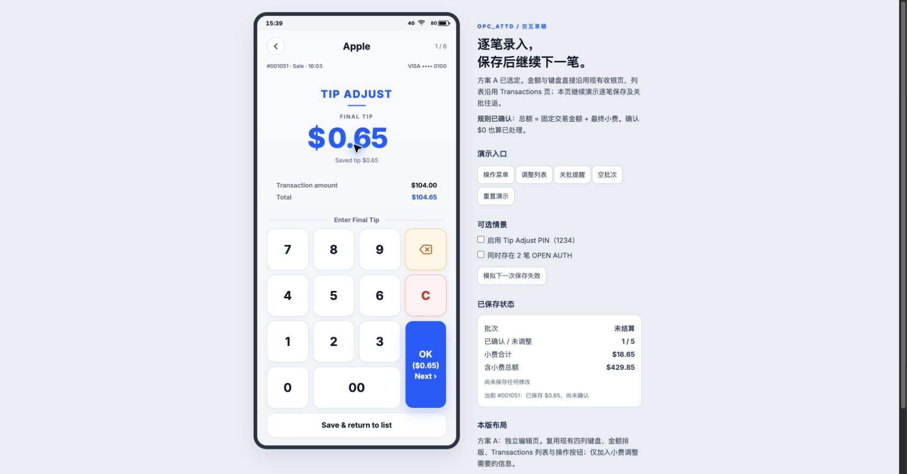

# OPC_ATTD Tip Adjust：方案 A 与现有设计语言

回答的问题：在现有 375 × 812 终端界面内，哪种编辑布局更适合逐笔保存，以及如何从关批提醒进入调整并返回关批？

这是独立研究分支中的可丢弃 UI 草稿，不是正式功能。它遵循已确认的[金额与批次规则](https://github.com/xtfllbl/OPC/issues/3#issuecomment-5865236468)，交互选择在[交互议题](https://github.com/xtfllbl/OPC/issues/4)中评议。用户已选择方案 A，并明确要求沿用现有项目的金额输入、键盘及整体设计语言。此前自定义输入框、三列键盘和卡片列表不作为最终设计依据。

## 运行

在本分支仓库根目录运行：

```sh
python3 -m http.server 8768 --bind 127.0.0.1
```

打开 [A：独立编辑页](http://127.0.0.1:8768/OPC_ATTD/index.html?tipPrototype=1&variant=A)。

- 同一 index.html 路由；当前固定展示已选定的 A，隐藏方案切换器。最初 B/C 探索保存在上一提交中。
- 只有本地地址且带 `tipPrototype=1` 时挂载草稿，其他地址不启用。
- 右侧说明/状态/情景按钮属于评议工具，终端产品不会包含它们。
- 调整数据只存在内存；刷新即可重置。无支付、打印或结算 API 调用。

## 初轮布局探索（历史记录）

| 方案 | 差异 | 需要评议的取舍 |
| --- | --- | --- |
| A 独立编辑页（建议） | 从列表进入完整编辑页，底部保存按钮固定 | 金额和完整数字键盘最清楚，返回列表多一步 |
| B 底部编辑面板 | 保留列表背景，面板内编辑与保存 | 上下文可见，但屏幕更拥挤 |
| C 列表内展开 | 选中行下方展开金额与键盘 | 可上下对照，编辑与列表共用滚动，保存按钮可能需要滚动 |



[修正版列表](a-native-list.jpg) · [修正版关批提醒](a-native-close-batch.jpg)

初轮草稿仅作历史记录：

[B 编辑面板截图](b-editor.jpg) · [C 列表内展开截图](c-editor.jpg) · [列表截图](a-list.jpg) · [关批提醒截图](close-batch.jpg)

## 方案 A 的交互及风格约束

- 列表默认所有符合条件的交易，最新在前；支持票据号/卡尾号搜索、All / Not adjusted / Adjusted 筛选。
- 每行强调固定交易金额，展示已保存小费、总额、卡尾号和调整确认状态。
- 编辑页展示固定交易金额、Final tip 和实时 Total；展示 Saved tip 便于核对。
- 键盘沿用现有 7/8/9 在上排的四列布局，橙色退格、红色 C、00 和纵向蓝色 OK；OK 保存并继续下一笔（Next），最后一笔显示 Finish；独立 Save & return to list 按钮保存并回列表。All 中已调整交易可再次编辑。
- 从关批提醒选择 Adjust Tips First 默认进入 Not adjusted，显示 Return to Close Batch；返回后由用户再次点击 Close Batch，不自动结算。
- 关批有未调整记录时展示数量与两个出口；没有时保留普通关批确认。继续结算仍经过现有 OPEN AUTH 检查。
- 独立 PIN 演示使用 1234，仅进入时验证；连续下一笔不重复验证。

## 已实际进行的浏览器检查

- 操作菜单：Tip Adjust 与 Close Batch 同级，点击进入列表。
- A：交易金额 $104.00，最终小费从 $0.65 改为 $5.00，显示 $109.00；保存后自动进入下一笔，合计更新。
- 模拟失败：输入 $0 保留，原有已保存金额不变；重试成功后变为 Adjusted。
- 相同金额首次确认：未调整笔数减少，交易总额不变。
- 关批：未调整笔数随保存变化；先调整进入未调整列表，返回仍在关批页；直接继续可到 OPEN AUTH 提醒，再完成演示结算。
- PIN：启用时显示输入，1234 通过；下一笔不重复请求。
- 未保存退出：显示继续编辑/放弃提示，放弃后原金额保留。
- 搜索无结果、空批次、B/C 布局切换与 C 保存返回均已走查。
- 进行了 JavaScript 语法检查；按 prototype 技能未新增自动化测试。未执行真实终端、支付或收单验证。

## 有意保留的原型边界

- OPEN AUTH 的 Review 出口只给出衔接说明，未复制原来的 Capture 流程。
- 关批页仅汇总草稿的六笔符合条件的演示交易；不代表正式全批次报表。
- 正式实现时需要接入共享交易数据、独立 PIN 配置、真实的保存结果和已有报表/小票。
- 选定 A；确认结论及风格约束以交互议题的 resolution comment 为准。

## 与既有项目的复用对应

- 金额与键盘：直接加载现有 `css/pos_home.css`，克隆 `index.html` 的 `.key-grid` 和全部按键 class/SVG，只将操作绑定改为本演示的小费保存。金额采用 `.amount-context`、`.amount-label`、`.amount-display`、`.currency`、`.amount-value`；不使用初稿蓝色描边金额输入框。
- 返回与操作按钮：使用 `css/attended.css` 的 `.attd-back`、`.attd-button`，弹窗和提示使用现有 `.attd-modal` / `.attd-dialog` / `.attd-toast` 样式。
- 列表：按 `transactions.html` 的表头、三列分隔行、卡品牌 SVG、搜索/筛选入口构建；原 CSS 在临时研究文件中添加作用域，以免影响同页其他已有组件。正式实现应复用/抽取这些既有样式，不维护一套独立的 Tip Adjust 视觉主题。
- 原型修正仍在独立分支，未合入主工作区或部署。

修正版浏览器检查：C → 5 → 00 显示最终小费 $5.00、总额 $109.00，OK 进入下一笔；搜索/筛选与关批提醒仍可操作。原页与修正版数字键的实测背景、边框、圆角、字号、字重一致（白色、1px #DFE5EF、15px、23px、700）。
