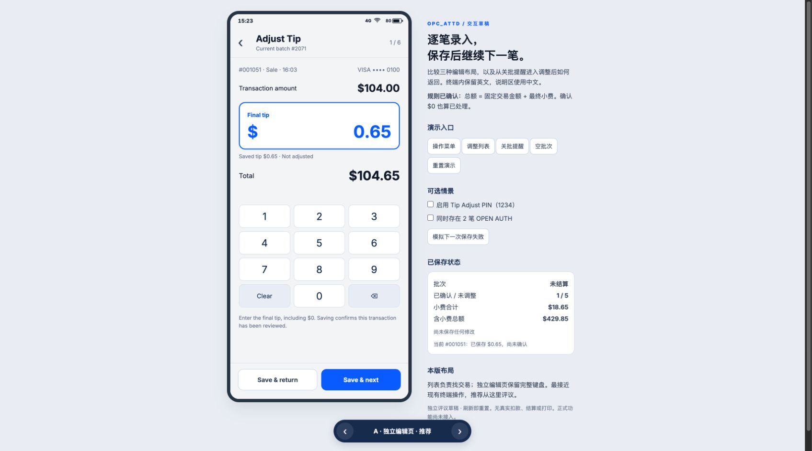

# OPC_ATTD Tip Adjust 交互草稿（待用户评议）

回答的问题：在现有 375 × 812 终端界面内，哪种编辑布局更适合逐笔保存，以及如何从关批提醒进入调整并返回关批？

这是独立研究分支中的可丢弃 UI 草稿，不是正式功能。它遵循已确认的[金额与批次规则](https://github.com/xtfllbl/OPC/issues/3#issuecomment-5865236468)，交互选择在[交互议题](https://github.com/xtfllbl/OPC/issues/4)中评议。当前无用户选定的最终布局。

## 运行

在本分支仓库根目录运行：

```sh
python3 -m http.server 8768 --bind 127.0.0.1
```

打开 [A：独立编辑页](http://127.0.0.1:8768/OPC_ATTD/index.html?tipPrototype=1&variant=A)。

- 同一 index.html 路由；底部箭头或键盘左右键切换 `variant=A/B/C`。
- 只有本地地址且带 `tipPrototype=1` 时挂载草稿，其他地址不启用。
- 右侧说明/状态/情景按钮属于评议工具，终端产品不会包含它们。
- 调整数据只存在内存；刷新即可重置。无支付、打印或结算 API 调用。

## 三种布局

| 方案 | 差异 | 需要评议的取舍 |
| --- | --- | --- |
| A 独立编辑页（建议） | 从列表进入完整编辑页，底部保存按钮固定 | 金额和完整数字键盘最清楚，返回列表多一步 |
| B 底部编辑面板 | 保留列表背景，面板内编辑与保存 | 上下文可见，但屏幕更拥挤 |
| C 列表内展开 | 选中行下方展开金额与键盘 | 可上下对照，编辑与列表共用滚动，保存按钮可能需要滚动 |



[B 编辑面板截图](b-editor.jpg) · [C 列表内展开截图](c-editor.jpg) · [列表截图](a-list.jpg) · [关批提醒截图](close-batch.jpg)

## 本稿提出的交互细节（待反馈）

- 列表默认所有符合条件的交易，最新在前；支持票据号/卡尾号搜索、All / Not adjusted / Adjusted 筛选。
- 每行强调固定交易金额，展示已保存小费、总额、卡尾号和调整确认状态。
- 编辑页展示固定交易金额、Final tip 和实时 Total；展示 Saved tip 便于核对。
- Save & return 回列表；Save & next 沿进入编辑时当前筛选/搜索结果的顺序继续；最后一笔使用 Save & finish 回列表。All 中的已调整交易仍可再次编辑。
- 从关批提醒选择 Adjust Tips First 默认进入 Not adjusted，显示 Return to Close Batch；返回后由用户再次点击 Close Batch，不自动结算。
- 关批有未调整记录时展示数量与两个出口；没有时保留普通关批确认。继续结算仍经过现有 OPEN AUTH 检查。
- 独立 PIN 演示使用 1234，仅进入时验证；连续下一笔不重复验证。

## 已实际进行的浏览器检查

- 操作菜单：Tip Adjust 与 Close Batch 同级，点击进入列表。
- A：交易金额 $104.00，最终小费从 $0.65 改为 $5.00，显示 $109.00；保存后自动进入下一笔，合计更新。
- 模拟失败：输入 $0 保留，原有已保存金额不变；重试成功后变为 Adjusted。
- 相同金额首次确认：未调整笔数减少，交易总额不变。
- 关批：未调整笔数随保存变化；先调整进入未调整列表，返回仍在关批页；直接继续可到 OPEN AUTH 提醒，再完成演示结算。
- PIN：启用时显示输入，1234 通过；下一笔不重复请求。
- 未保存退出：显示继续编辑/放弃提示，放弃后原金额保留。
- 搜索无结果、空批次、B/C 布局切换与 C 保存返回均已走查。
- 进行了 JavaScript 语法检查；按 prototype 技能未新增自动化测试。未执行真实终端、支付或收单验证。

## 有意保留的原型边界

- OPEN AUTH 的 Review 出口只给出衔接说明，未复制原来的 Capture 流程。
- 关批页仅汇总草稿的六笔符合条件的演示交易；不代表正式全批次报表。
- 正式实现时需要接入共享交易数据、独立 PIN 配置、真实的保存结果和已有报表/小票。
- 所有布局与路径均为本轮待评议建议；确认结论以交互议题的 resolution comment 为准。
